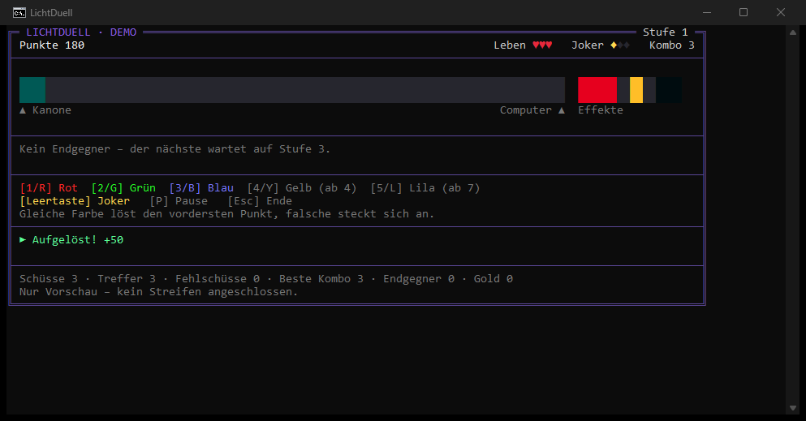
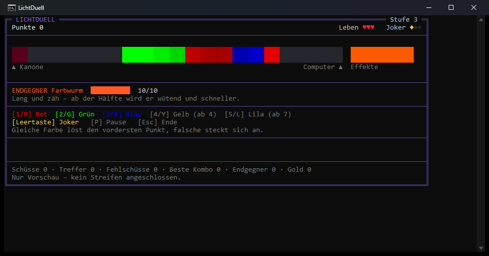
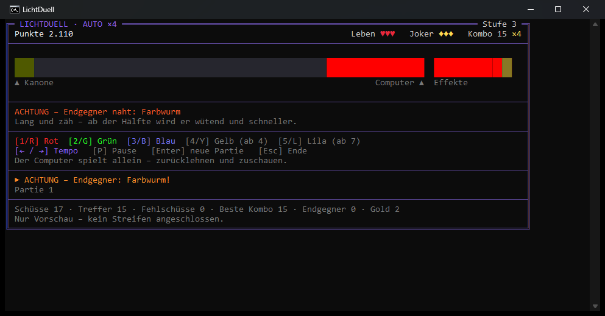

<div align="center">

# LichtDuell

**Farbduell auf dem Govee-LED-Streifen – der Computer schießt, du schießt zurück, Endgegner inklusive. Nur mit der Tastatur.**

     

[Spielen](#spielen) · [Automodus](#automodus) · [Spielregeln](#spielregeln) · [Endgegner](#endgegner) · [Effektbereich](#effektbereich) · [Einrichten](#einrichten) · [Optionen](#optionen) · [Bauen](#bauen) · [Wie es funktioniert](#wie-es-funktioniert) · [Fehlersuche](#fehlersuche) · [Stand](#stand)

</div>





*Klassisches Konsolenfenster (Doppelklick auf die EXE), per `PrintWindow` fotografiert. Der breite Balken ist dasselbe Bild wie am Streifen: links die Kanone, dann das Kampffeld, rechts daneben der Effektbereich.*

## Spielen

Dein Streifen ist eingerichtet, die Werte stehen in `%LOCALAPPDATA%\StreamWizard\LichtDuell\einstellungen.txt`. Also nur:

```bash
out\rel\bin\Release\LichtDuell.exe
```

- **Kampffeld:** die Decke über den Vorhängen, von der linken bis zur rechten Ecke (21 Abschnitte). Links an der Ecke sitzt deine Kanone, rechts an der Ecke der Computer.
- **Aus:** der Anfang hinter dem Bett und die linke Wand hoch (11 Abschnitte).
- **Effektbereich:** hinter der rechten Ecke bis hinunter zu den Waben (8 Abschnitte).

Der Computer spielt vor, eine Farbtaste oder die Leertaste übernimmt:

```bash
out\rel\bin\Release\LichtDuell.exe --demo
```

Gleich zum ersten Endgegner:

```bash
out\rel\bin\Release\LichtDuell.exe --stufe 3
```

Beim Beenden mit **Esc** wartet das Spiel 2 s und schaltet den Razer-Modus ab – dann kehrt der Streifen in sein Licht von vorher zurück.

## Automodus

Nur der Computer spielt – endlos, Partie um Partie. **Taste `A` schaltet ihn jederzeit an und aus**, mitten in der Partie: an → der Computer übernimmt mit deinem zuletzt gewählten Tempo; aus → du spielst an derselben Stelle weiter, das Tempo springt auf ×1. Gleich mit Automodus starten:

```bash
out\rel\bin\Release\LichtDuell.exe --auto langsam
```

```bash
out\rel\bin\Release\LichtDuell.exe --auto schnell
```

| Modus | Tempo | Computerspieler | nach dem Spielende |
|---|---|---|---|
| `langsam` | ×0,5 | ruhig, überlegt lange, selten daneben – Lichtstimmung fürs Zimmer | 8 s Pause |
| `normal` | ×1 | wie die Demo | 6 s Pause |
| `schnell` | ×4 | Blitzreflexe, Joker ohne Zögern – Feuerwerk an der Decke | 3 s Pause |

- **A** an/aus, **← / →** ändert das Tempo live in Stufen von ×0,25 bis ×8, **Enter** startet sofort eine neue Partie, **P** pausiert. Ohne `--auto` beginnt A mit „normal“ (×1).
- Eine Partie, in der der Computer mitgespielt hat, zählt nicht für die Bestenliste – auch wenn du sie selbst zu Ende spielst.
- **Zeitlupe:** Fällt ein Endgegner oder endet die Partie, läuft das Spiel 1,6 s mit Viertel-Tempo – Feuerwerk und roter Vorhang wirken nach.
- Unter der Meldung steht **„Partie N · bester Lauf: Stufe X, Y Punkte“**; in die Bestenliste zählt der Computer nicht.
- Ton nur bei großen Momenten (Joker, Gold, neue Stufe, Endgegner, Spielende) – bei ×4 wäre jeder Schuss Dauerfeuer.
- Im Test schlägt der schnelle Computerspieler auf deinen 21 Zellen alle drei Endgegner (Stufe 10), der langsame schafft den Farbwurm.



## Spielregeln

- Der Computer schickt farbige Punkte los, ab Stufe 4 auch Klumpen aus zwei, ab Stufe 7 aus drei Farben.
- Du schießt mit einer Farbtaste zurück. Der Schuss trifft immer die **vorderste** Farbe des **vordersten** Klumpens:
  - **gleiche Farbe** → die Farbe verschwindet;
  - **falsche Farbe** → der Schuss **steckt sich vorn an**: der Klumpen wird länger, rückt eine Zelle näher, und deine falsche Farbe muss als Erstes wieder weg.
- Erreicht ein Klumpen die Kanone, ist ein Leben weg. Drei Leben zum Start, höchstens fünf.
- **Kombo:** Treffer in Folge ohne Fehlschuss. Ab 5 zählen Treffer doppelt, ab 10 dreifach … bis fünffach.
- **Joker** (Leertaste): Regenbogenschuss, passt auf jede Farbe. Einer zum Start, einer je 8er-Kombo, je Goldpunkt und je besiegtem Endgegner, höchstens drei. Ist einer bereit, glimmt die Kanone im Regenbogen.
- **Goldpunkt:** funkelt, ist schnell, jeder Schuss trifft – 100 × Stufe Punkte und ein Joker. Entwischt er, kostet das nichts.
- Neue Farben kommen nach einem Endgegner: **Gelb ab Stufe 4**, **Lila ab Stufe 7**.

Punkte: 10 × Stufe × Kombo-Faktor je Treffer, 50 × Stufe je aufgelöstem Klumpen, 500 × Stufe je Endgegner. Fehlschüsse kosten keine Punkte – die Strafe ist der längere Klumpen und die verlorene Kombo. Die **Bestenliste** (Top 5) zählt Spiele ab Stufe 1 ohne Demo.

| Taste | Wirkung |
|---|---|
| `1` / `R` | Rot |
| `2` / `G` | Grün |
| `3` / `B` | Blau |
| `4` / `Y` | Gelb (ab Stufe 4) |
| `5` / `L` | Lila (ab Stufe 7) |
| `Leertaste` | Joker |
| `A` | Automodus an/aus – der Computer übernimmt bzw. gibt ab |
| `← / →` | im Automodus: Tempo |
| `P` | Pause |
| `Enter` | neues Spiel nach dem Ende |
| `Esc` / `Strg+C` | beenden |

Ziffernblock 1–5 geht auch. Gehaltene Tasten feuern nur einmal.

## Endgegner

Jede dritte Stufe. Vorher blinkt das Computerende 2,5 s rot. Sieg: ein Leben, ein Joker, die nächste Stufe und ein Feuerwerk. Erreicht ein Endgegner die Kanone, **beißt** er: ein Leben weg, er verliert zwei Glieder und weicht sechs Zellen zurück.

| Stufe | Gegner | Was er tut |
|---|---|---|
| 3, 12, 21 | **Farbwurm** | Lange Kette aus Farbläufen, langsam. Ab der Hälfte wird er **wütend**: pulsiert schneller und rückt 1,7× so schnell vor. |
| 6, 15, 24 | **Chamäleon** | Alle Glieder wechseln gemeinsam im Takt die Farbe. Kurz vor dem Wechsel **flackert** er. Den Takt lesen – oder einen Joker nehmen. |
| 9, 18, 27 | **Kanonier** | Bleibt bei 55 % des Felds stehen und schießt schnelle Einzelpunkte – im Takt und als **Gegenschuss auf jeden Treffer**. Vor jedem Schuss blitzt sein Kopf. |

Ab Stufe 12 kommen alle drei stärker wieder.

## Effektbereich

Das Stück hinter der rechten Zimmerecke gehört nicht zum Kampf, sondern zeigt, was los ist – von der Ecke aus:

| Lage | Anzeige |
|---|---|
| normal | **Leben** rot · Lücke · **Joker** gold · Lücke · **Kombo-Leiste** hellblau bis zum nächsten Joker |
| Endgegner naht | ganzer Bereich blinkt rot |
| Endgegnerkampf | seine **Lebensleiste** in Orange, wütend schneller pulsierend |
| Ereignisse | neue Stufe: grüner Lauf · Leben weg: roter Blitz · Sieg: Regenbogen · Gold/Joker: Funkeln |
| Spielende | glimmt rot |

## Einrichten

Nur nötig, wenn du den Streifen umhängst. Testbild starten und auf den Streifen schauen:

```bash
out\rel\bin\Release\LichtDuell.exe --testbild
```

- **Weiß (pulsiert)** = deine Kanone, **Lila** = Computer, **Grün/Blau** im Wechsel = Kampffeld, **Orange** = Effektbereich, davor ist alles **aus**.
- **← / →** Kampf früher/später beginnen lassen · **↑ / ↓** Effektbereich größer/kleiner · **S** speichern · **Esc** beenden.
- Vorher ins Konsolenfenster klicken, sonst kommen die Tasten nicht an.

Dein Streifen wurde am 2026-10-18 so eingerichtet: 40 Abschnitte, **11 aus**, **21 Kampffeld**, **8 Effektbereich**.

## Optionen

| Option | Wirkung | Vorgabe |
|---|---|---|
| `--ip <adresse>` | Streifen direkt ansprechen, keine Suche | aus der Datei, sonst Suche |
| `--segmente <8–84>` | Abschnitte, in die der Streifen geteilt wird – **H612C: höchstens 40** | wie `--leds` |
| `--versatz <n>` | Abschnitte am Kanonen-Ende aus | 0 |
| `--effektbereich <n>` | Abschnitte am Computer-Ende für den Effektbereich | 0 |
| `--leds <8–84>` | Spielzellen; mit `--segmente` sonst so viele wie das Kampffeld | 30 |
| `--fps <5–60>` | Bilder je Sekunde an den Streifen | 30 |
| `--helligkeit <1–100>` | Helligkeit in Prozent (in Software gerechnet) | 100 |
| `--umgedreht` | Kanone am anderen Ende | aus |
| `--stufe <1–30>` | Startstufe (3/6/9: Endgegner) | 1 |
| `--demo` | der Computer spielt, eine Taste übernimmt | aus |
| `--auto <langsam\|normal\|schnell>` | nur der Computer spielt, endlos | aus |
| `--ohne-ton` | keine Klänge | Ton an |
| `--seed <zahl>` | feste Zufallsfolge | Uhrzeit |
| `--nur-vorschau` | ohne Streifen | aus |
| `--testbild` | Einrichten (siehe oben) | – |
| `--suchen` | Geräte samt Zustand auflisten und beenden | – |
| `--speichern` | aktuelle Streifen-Werte in die Einstellungsdatei schreiben | – |
| `--ohne-einstellungen` | Einstellungsdatei nicht lesen | – |

Reihenfolge: Vorgaben → `einstellungen.txt` → Kommandozeile. Die Datei ist von Hand änderbar (`schlüssel = wert`, `#` für Kommentare); ein Tippfehler bricht mit Zeilennummer ab, statt still mit Vorgaben zu spielen.

## Bauen

```bash
pwsh -File build.ps1
```

Stufen check → configure → build → test. Ergebnis: `out\rel\bin\Release\LichtDuell.exe`. Bewusst ohne Setup und Signatur. Braucht Build Tools 2022 (MSVC 14.44) und CMake ≥ 3.30. Die Tastatur-Probe läuft getrennt:

```bash
ctest --test-dir out/rel -C Release -L integration --output-on-failure
```

## Wie es funktioniert

```
Tastatur ──► Konsole ──► Spiellogik ──► Kampffeld ─┐
   ▲                         │  └──► Effektbereich ─┤──► [ aus | Feld | Effekte ] ──► UDP 4003 ──► H612C
Autopilot (--demo) ──────────┘                      │        40 Abschnitte, ≤ 30 fps
                                    Konsolenbild ◄──┘──► Ton (PlaySound, im Speicher erzeugt)
```

- **Offizielle Govee-LAN-API:** JSON über UDP, Suche per Multicast `239.255.255.250:4001`, Antworten an Port `4002`, Befehle an Port `4003`. Sie kennt nur **eine** Farbe für den ganzen Streifen. `devStatus` liefert An/Aus und Helligkeit, aber keine Szene.
- **Einzelne Abschnitte** gehen nur über den nicht dokumentierten **`razer`-Befehl** (derselbe Weg wie Govee Desktop). Aufbau nach [OpenRGB-MR 2172](https://gitlab.com/CalcProgrammer1/OpenRGB/-/merge_requests/2172): Paket `BB 00 <Länge> <Befehl> <Daten> <XOR>` als Base64 in `{"msg":{"cmd":"razer","data":{"pt":"…"}}}`; `B1 01`/`B1 00` schaltet den Modus, `B0 <Verlauf> <Anzahl> <R G B>…` ist ein Bild. Der Streifen verteilt die gesendeten Farben gleichmäßig auf seine Länge.
- **Am H612C gemessen:** 30 und 40 Farben je Bild nimmt er an, 50 bis 80 nicht. Beim Beenden braucht er **2 s Ruhe und dreimal Razer-Aus**, sonst bleibt er auf dem letzten Bild stehen.
- **Ton** ohne Dateien: kurze Töne, im Speicher als WAV gebaut; ein Vorrang-Planer lässt das Schussgeräusch keine Fanfare abschneiden.
- **Autopilot** sieht nur, was ein Mensch sieht, nimmt fliegende Schüsse vorweg und rechnet beim Chamäleon den Farbwechsel mit. Fehlerfrei schlägt er im Test alle drei Endgegner bis Stufe 10.
- **Spieltakt:** feste Schritte von 1/60 s, das Tempo bestimmt nur, wie viele je Bild – auch ×8 rechnet so genau wie ×1.
- **Sparsam zeichnen:** Bild, Streifen und Konsole im 30er-Takt; die Konsole bekommt nur die Zeilen, die sich geändert haben. Gemessen (Demo, 15 s, Konsolenfenster):

| | Spiel | Konsole (conhost) |
|---|---|---|
| vorher | 0,9–1,6 % eines Kerns | 7,4–8,6 % |
| nachher | 0,5–1,1 % | **2,2–2,4 %** |
| `--auto schnell` | 1,1 % | 2,3 % |

Module: `core` (Farben, Text, Dateien), `game` (Regeln, Endgegner, Darstellung, Effektbereich, Autopilot, Testbild), `govee` (Protokoll, UDP, Ausgabe), `sound`, `score` (Bestenliste), `console` (VT-Bild, Tasten), `cli` (Optionen, Einstellungsdatei), `app` (Schleife).

## Fehlersuche

| Meldung / Verhalten | Ursache und Abhilfe |
|---|---|
| Streifen bleibt nach einem Absturz auf dem letzten Bild stehen | Das Aus kam nicht an (Absturz, Taskmanager, Tab im Claude-Terminal geschlossen). `LichtDuell --testbild` starten und mit Esc beenden. |
| Streifen zeigt nichts | `--segmente` über 40? Der H612C nimmt dann keine Bilder an. |
| „Kein Govee-Gerät hat auf die Suche geantwortet“ | LAN-Steuerung in der App aus, anderes Netz, oder die Windows-Firewall blockt eingehend UDP 4002. `--ip` nehmen. |
| „UDP-Port 4002 ist belegt“ | Govee Desktop o. Ä. lauscht schon. Beenden; mit `--ip` fällt nur die Zustandsabfrage weg. |
| „einstellungen.txt Zeile N: …“ | Tippfehler in der Datei – Zeile korrigieren oder `--testbild` und S neu schreiben lassen. |
| Pfeiltasten im Testbild wirken nicht | Erst ins Konsolenfenster klicken. |
| Kein Ton | Ohne Audiogerät bleibt es still; `--ohne-ton` schaltet ihn bewusst ab. |

## Stand

- ✅ Spiellogik, drei Endgegner, Kombo, Joker, Gold – jede Sonderregel mit Gegenprobe rot/grün
- ✅ Autopilot schlägt fehlerfrei alle drei Endgegner bis Stufe 10 (Test)
- ✅ Razer-Pakete, Base64, Scan- und Zustandsantworten, Layout aus/Feld/Effekte, Einstellungsdatei – Gegenproben rot/grün
- ✅ Tastatur in echter Konsole inkl. Pfeiltasten im Testbild und Taste A: Probe 19/19, Gegenproben rot
- ✅ **Am Govee H612C:** Razer-Modus geht, 40 Abschnitte gehen, ab 50 nicht; Richtung stimmt; Kanone an der linken Deckenecke, Lila an der rechten (vom Nutzer gesehen); nach Esc kehrt das Licht von vorher zurück
- ✅ Einstellungsdatei echt unter `%LOCALAPPDATA%` gespeichert (von außerhalb der Claude-App gegengeprüft)
- ✅ Erste Runde am Streifen gespielt (Stufe 3, Farbwurm), Bestenliste hat den Eintrag geschrieben
- ✅ Anzeige im klassischen Konsolenfenster fotografiert: alle Zeichen da, Rahmen gerade
- ✅ Automodus langsam/schnell mit Tempo, Zeitlupe und Partienzähler; im Konsolenfenster fotografiert; Konsolenlast um ~70 % gesenkt (gemessen)
- ⏳ Automodus am Streifen noch nicht angeschaut
- ⏳ Effektbereich am Streifen während eines Spiels noch nicht bewusst beobachtet
- ⏳ Klänge nicht angehört; nur der WAV-Aufbau ist getestet
- ⏳ Schwierigkeit für Menschen nicht ausbalanciert (`src/game/level.cpp`, `src/game/boss.cpp`)
- ⏳ Ob weniger als 2 s Ruhe vor dem Aus reichen, ist nicht getrennt geprüft
